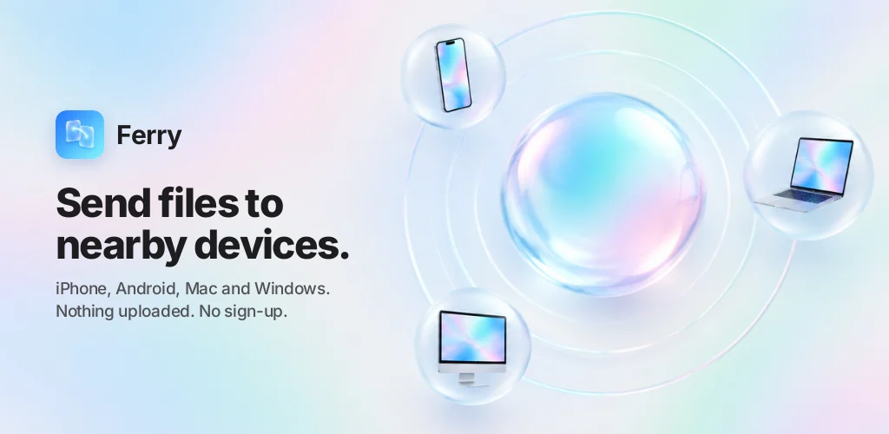
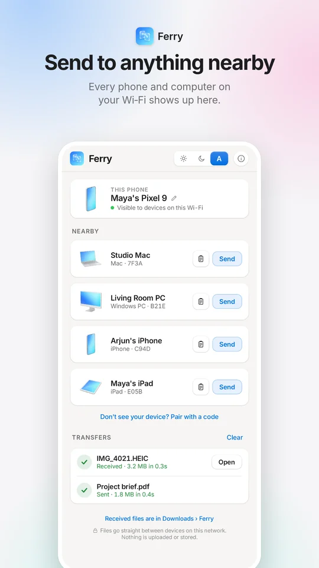
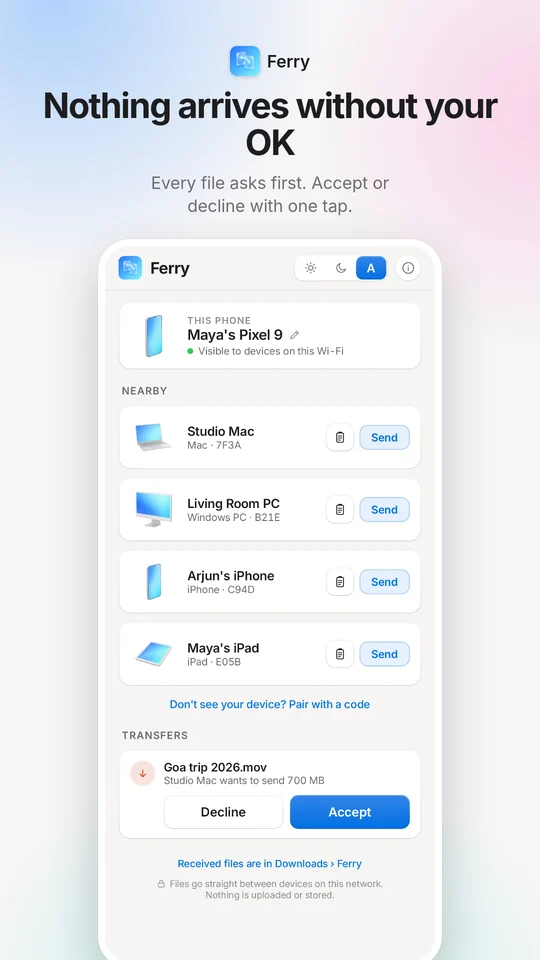
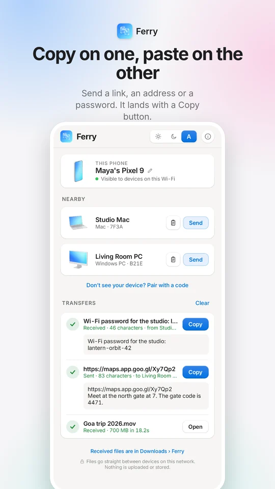
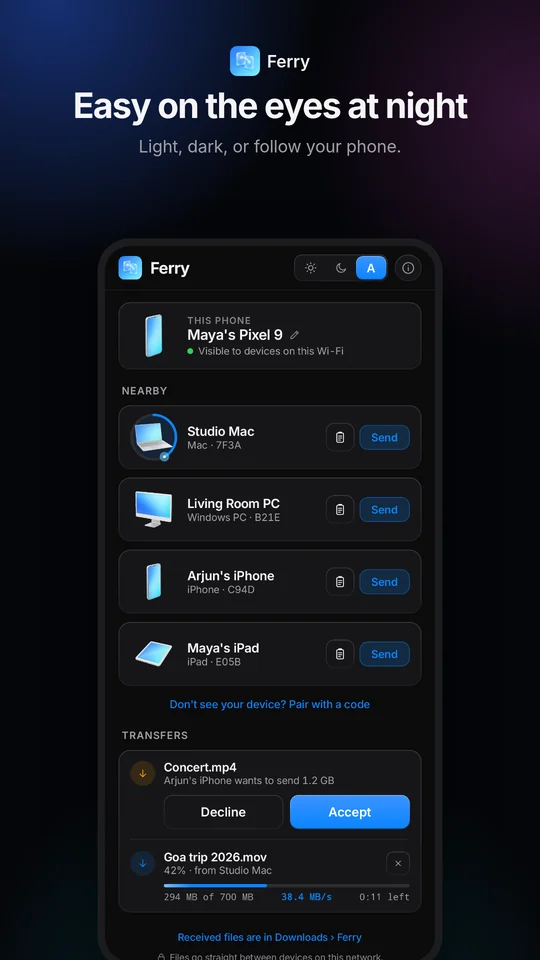
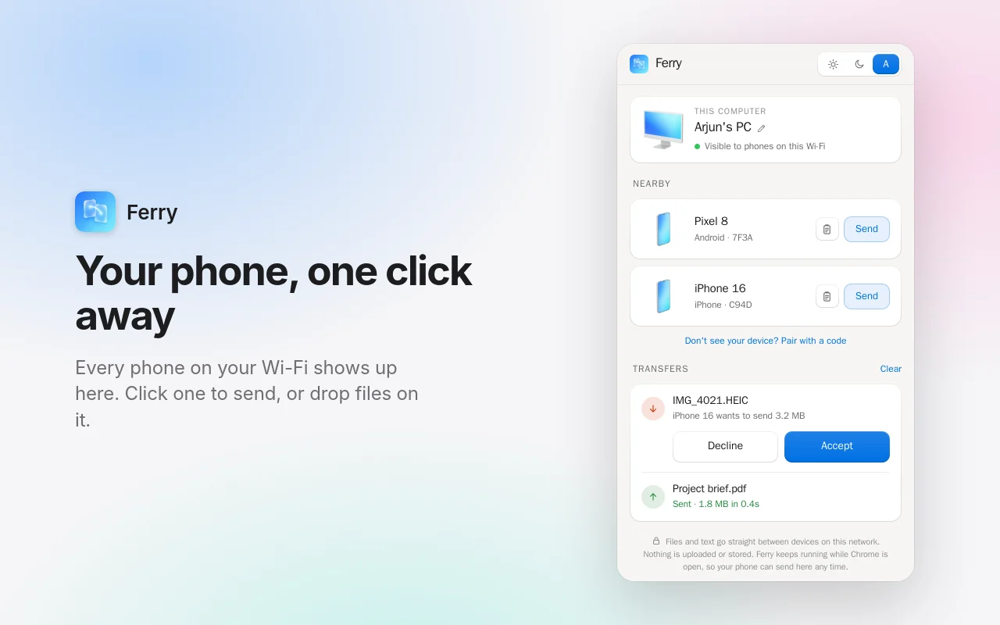
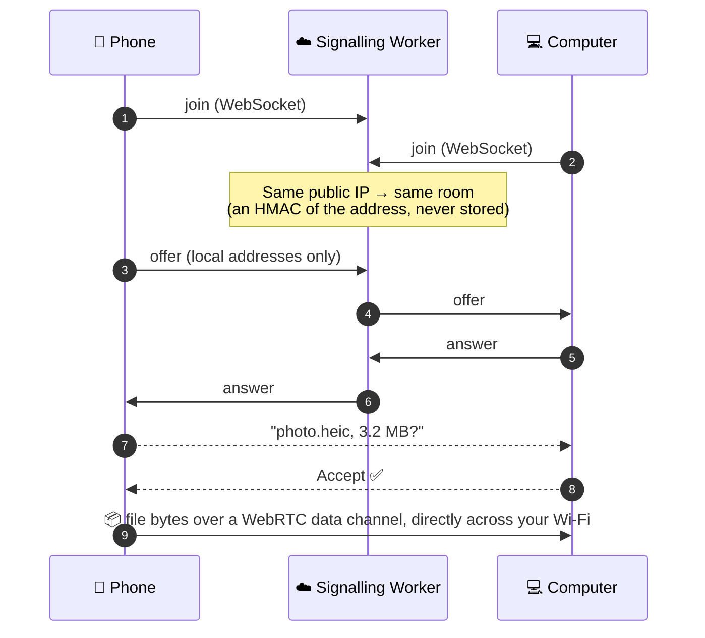

<div align="center">



<h1>Ferry</h1>

<p><b>AirDrop-style sharing for every device on your Wi‑Fi.</b><br>
iPhone to Windows, Android to Mac, phone to phone. No account, no install, nothing uploaded.</p>

<p>
<a href="https://ferry.luitlabs.in"></a>
<a href="https://play.google.com/store/apps/details?id=com.dorxon.ferry"></a>
<a href="https://chromewebstore.google.com/detail/ferry-send-files-nearby/aigfljpajgonlpcmpgdppnpnbdggcakn"></a>
</p>

<p>
<a href="LICENSE"></a>


</p>

</div>

<br>

<table>
<tr>
<td width="25%"></td>
<td width="25%"></td>
<td width="25%"></td>
<td width="25%"></td>
</tr>
</table>

## ✨ Why Ferry

<table>
<tr>
<td width="33%" valign="top">

### 🌐 Works on everything
Any browser is a Ferry device: Safari on iPhone, Chrome on Windows, Firefox on Linux. There's also a native Android app and a Chrome extension that keeps your computer ready.

</td>
<td width="33%" valign="top">

### 🔒 Nothing is uploaded
Files go straight from one device to the other over WebRTC. The server only introduces devices to each other. It has no endpoint that accepts a file and stores nothing.

</td>
<td width="33%" valign="top">

### ✋ Nothing arrives uninvited
Every file waits for the receiver to tap **Accept**. Devices only see each other on the same network, or with a short-lived 6‑digit pairing code.

</td>
</tr>
<tr>
<td valign="top">

### ⚡ Wi‑Fi speed
No relay in the middle: bytes go device to device over your local network, as fast as it allows. Big files go straight to disk as they arrive, wherever the browser allows it.

</td>
<td valign="top">

### 📋 A shared clipboard
Send a link, an address or a password. It lands with a **Copy** button and never touches the clipboard until you press it.

</td>
<td valign="top">

### 🪶 Tiny and free to run
Vanilla JS with no build step. The server is one Cloudflare Worker that fits the **free plan**: it can't run up a bill.

</td>
</tr>
</table>

## 🖥️ On your computer

<p align="center"></p>

<p align="center"><i>Ferry for Chrome keeps your computer visible to your phones whenever Chrome is open.<br>Incoming files ask on a notification.</i></p>

## 🧭 How it works



- **Same network only, by construction.** No TURN, no STUN: each side offers
  WebRTC nothing but its local addresses, so two devices connect only if they
  can reach each other on the LAN. Nothing here can carry a transfer across the
  internet.
- **The network is the room.** Devices meet when they share a public IP (or
  IPv6 /64). The room id is a keyed HMAC of it, so the address is never stored.
  A room only groups devices; it never authorises a transfer.
- **Networks that hide devices** (client isolation, guest Wi‑Fi) can pair with
  a 6‑digit code instead.
- **Reliable transfers.** Chunks carry their byte offset. The sender paces on
  `bufferedAmount`, and the receiver confirms every byte before the sender shows
  **Sent**. A dropped connection says so, with **Try again**.

## 📦 What's in this repo

| Path | What it is |
|---|---|
| [`public/`](public) | The web app: vanilla JS, no build step, no dependencies |
| [`cloudflare/`](cloudflare) | The signalling server: one Worker + a Durable Object per room |
| [`extension/`](extension) | Ferry for Chrome (Manifest V3): side panel + an offscreen engine |
| [`native-android/`](native-android) | Ferry for Android: Kotlin, Jetpack Compose and WebRTC, speaking the web client's exact protocol |
| [`tests/`](tests) | End-to-end tests with real browsers (Playwright) |

## 🚀 Run it locally

```sh
cd cloudflare && npm ci
npx wrangler dev --port 8899 --var ALLOW_TEST_IP:1
```

Then open **http://127.0.0.1:8899/?debug** in two browser windows and send
yourself a file.

> [!NOTE]
> `ALLOW_TEST_IP` lets the tests pretend to be on different networks. It is
> for local testing only: never set it in production.

<details>
<summary><b>🧪 Tests</b></summary>
<br>

Everything runs in Docker, so nothing needs installing:

```sh
docker run --rm --network host --ipc=host -v "$PWD/tests:/t:ro" \
  mcr.microsoft.com/playwright/python:v1.49.1-jammy \
  sh -c "pip install -q playwright==1.49.1 && python3 /t/e2e.py 67108864 http://127.0.0.1:8899/"
```

| Test | Covers |
|---|---|
| `e2e.py` | A transfer between two pages: the bytes match, and only `host` ICE candidates were used |
| `e2e_text.py` | The clipboard: long text in parts, paste to send |
| `e2e_pair.py` | Pairing codes across "networks" |
| `e2e_reconnect.py` | Signalling dropping mid-transfer |
| `e2e_lost.py` | The receiver vanishing mid-transfer, then **Try again** |
| `e2e_spool.py` | Big files written to the browser's private storage |
| `e2e_extension.py` | The Chrome extension, both directions |

The Android tests run on the JVM: two protocol sessions back to back,
conformance against message traces recorded between real browsers, and
renders of the real screens. Run `./gradlew testDebugUnitTest` in
`native-android/`.

</details>

<details>
<summary><b>🏠 Run your own instance</b></summary>
<br>

You're welcome to. Please run your **own** server rather than pointing builds
at `ferry.luitlabs.in`.

1. **Server**:
   - `npx wrangler secret put ROOM_SALT` with a long random value. Without it a
     public default is used and room ids become guessable.
   - In `cloudflare/wrangler.jsonc`, set `ALLOWED_ORIGINS` to your extension's id.
   - `npx wrangler deploy`, then add a route or custom domain. HTTPS is
     required: WebRTC needs a secure context.
2. **Android**:
   - Change the `applicationId`, app name and icon.
   - Point it at your server with the Gradle property `bdServer`
     (`-PbdServer=https://your.host`). Until you do, builds use the placeholder
     `https://ferry.example` and connect nowhere.
   - `native-android/build.sh` signs with `browserdrop-android.jks` and
     `browserdrop-android.env` (`ANDROID_KEYSTORE_PASSWORD`, `ANDROID_KEY_ALIAS`)
     from `$FERRY_SECRETS`.
3. **Chrome extension**: set your server in `extension/config.js` and the
   manifest's host permission, then load it unpacked or build it with
   `extension/build.sh`.

A fork needs its own name and icon: see [TRADEMARKS.md](TRADEMARKS.md).

</details>

<details>
<summary><b>📶 Requirements and limits</b></summary>
<br>

- Both devices must reach each other directly on the LAN. Client isolation,
  separate VLANs and guest SSIDs block that. Use a pairing code, or a network
  that allows it.
- Keep Ferry in front on an iPhone during a transfer. iOS suspends background
  tabs.

</details>

<details>
<summary><b>🍎 Why it isn't AirDrop</b></summary>
<br>

A browser can't appear in an iPhone's AirDrop sheet, at any level of effort:

1. **Discovery** is Bluetooth LE advertising. Web Bluetooth can scan but never
   advertise.
2. **Transport** is AWDL, Apple's own peer-to-peer link layer. It needs
   driver-level access that no web page, and no Windows Wi‑Fi driver, has.
3. **Authentication** uses Apple-signed device certificates.

Ferry takes the route that works everywhere: the Wi‑Fi you're already on.

</details>

## 🤝 Contributing

Issues and pull requests are welcome. Start with [CONTRIBUTING.md](CONTRIBUTING.md).
Found a security problem? Please report it privately: see [SECURITY.md](SECURITY.md).

## 📄 Licence

Copyright © 2026 Luitlabs. Ferry is free software under the
**[GNU Affero General Public License v3.0](LICENSE)**. You may use, study,
change and share it. If you distribute it, or run a modified version as a
service for others, you must offer your source under the same licence.

Third-party parts keep their own licences ([NOTICE](NOTICE)). The Ferry name
and logo are trademarks of Luitlabs ([TRADEMARKS.md](TRADEMARKS.md)).

<div align="center">
<br>
<sub>Made by Luitlabs · <a href="https://ferry.luitlabs.in">ferry.luitlabs.in</a></sub>
</div>
